# Dossier de Conception UML — UniRide (ISET Nabeul)
**Projet d'Intégration : Plateforme mobile de covoiturage étudiant intelligent**  
**Auteurs :** Bahri Hajer · Bahloul Zeineb · Ben Taher Mohamed

---

## Sommaire
1. [Formalisme & Acteurs du Système](#1-formalisme--acteurs-du-système)
2. [Sprint 1 : Authentification, Profils & Véhicules (US1 à US4)](#sprint-1--authentification-profils--véhicules-us1-à-us4)
3. [Sprint 2 : Emploi du temps & Publication des trajets (US5, US6)](#sprint-2--emploi-du-temps--publication-des-trajets-us5-us6)
4. [Sprint 3 : Recherche, Carte, Réservation & Validation (US7 à US10)](#sprint-3--recherche-carte-réservation--validation-us7-à-us10)
5. [Sprint 4 : Matching intelligent, Notifications & Trajet en direct (US11, US13, US21)](#sprint-4--matching-intelligent-notifications--trajet-en-direct-us11-us13-us21)
6. [Sprint 5 : Communication, Évaluations, Signalements & Badges (US12, US14 à US17)](#sprint-5--communication-évaluations-signalements--badges-us12-us14-à-us17)
7. [Sprint 6 : Administration, Sécurité SOS & Tableaux de bord (US18 à US20, US22)](#sprint-6--administration-sécurité-sos--tableaux-de-bord-us18-à-us20-us22)
8. [Diagramme de Classes Global du Système](#8-diagramme-de-classes-global-du-système)

---

## 1. Formalisme & Acteurs du Système

Conformément au cahier des charges (§1.5) :
- **Étudiant (Générique) :** Acteur de base ayant un compte universitaire (`@isetn.tn`), pouvant agir alternativement en tant que **Passager** ou **Conducteur**.
- **Passager :** Étudiant cherchant un trajet, important son emploi du temps, réservant une place et évaluant son conducteur.
- **Conducteur :** Étudiant possédant un véhicule enregistré, publiant des trajets réguliers ou ponctuels, acceptant les passagers.
- **Administrateur :** Responsable du campus gérant les utilisateurs, traitant les signalements et supervisant les alertes SOS.
- **Système (Acteur secondaire) :** Moteur automatique calculant les scores de compatibilité et distribuant les notifications temps réel.
- **Service externe de Cartographie :** Fournisseur des tuiles et des calculs d'itinéraires (OpenStreetMap / Nominatim / OSRM).

---

## Sprint 1 : Authentification, Profils & Véhicules (US1 à US4)

### Objectifs
- **US1 :** S'inscrire avec un e-mail universitaire (`@isetn.tn`) et choisir sa filière ISET.
- **US2 :** Se connecter (JWT), se déconnecter et réinitialiser un mot de passe oublié via code reçu par e-mail.
- **US3 :** Gérer son profil (photo, bio, adresse de départ pour le calcul de proximité, préférences).
- **US4 :** Enregistrer et gérer son véhicule (marque, couleur, matricule, places, photo).

### Diagramme de Cas d'Utilisation — Sprint 1

```mermaid
flowchart LR
    user["👤 Étudiant"]
    cond["👤 Conducteur"]
    user <|-- cond

    subgraph Sprint1["UniRide — Sprint 1 (Gestion des comptes & Profils)"]
        UC1(["S'inscrire (US1)"])
        UC2(["S'authentifier (US2)"])
        UC2_1(["Réinitialiser mot de passe (US2)"])
        UC2_2(["Se déconnecter (US2)"])
        UC3(["Gérer mon profil (US3)"])
        UC3_1(["Définir préférences trajet (US3)"])
        UC3_2(["Renseigner adresse de départ (US3)"])
        UC3_3(["Ajouter contact de confiance (US3)"])
        UC4(["Gérer mon véhicule (US4)"])
        UC_VERIF(["Vérifier e-mail universitaire"])
    end

    user --> UC1
    user --> UC2
    user --> UC2_1
    user --> UC2_2
    user --> UC3
    cond --> UC4

    UC1 -.->|"«include»"| UC_VERIF
    UC3 -.->|"«extend»"| UC3_1
    UC3 -.->|"«extend»"| UC3_2
    UC3 -.->|"«extend»"| UC3_3
```

### Diagramme de Classes — Sprint 1

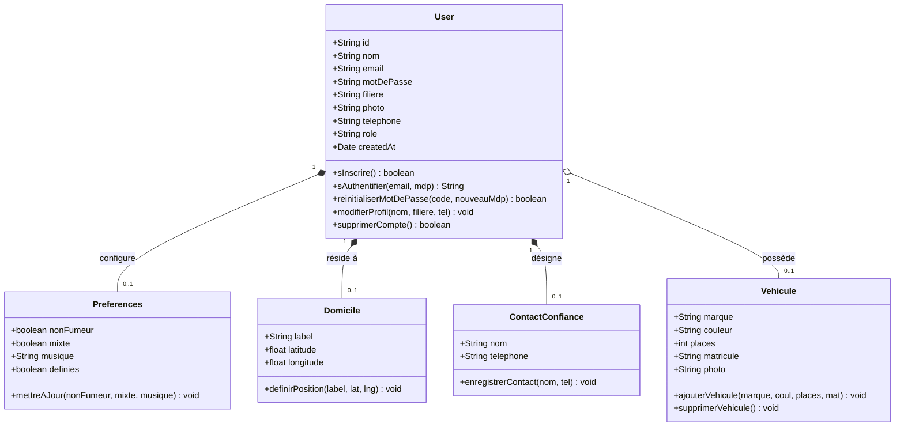

---

## Sprint 2 : Emploi du temps & Publication des trajets (US5, US6)

### Objectifs
- **US5 :** Importer l'emploi du temps (fichier `.ics` / saisie manuelle) pour détecter automatiquement les heures d'arrivée et de départ chaque jour.
- **US6 :** Publier un trajet ponctuel ou récurrent (du lundi au vendredi), calculer la durée, la distance et l'itinéraire via OpenStreetMap.

### Diagramme de Cas d'Utilisation — Sprint 2

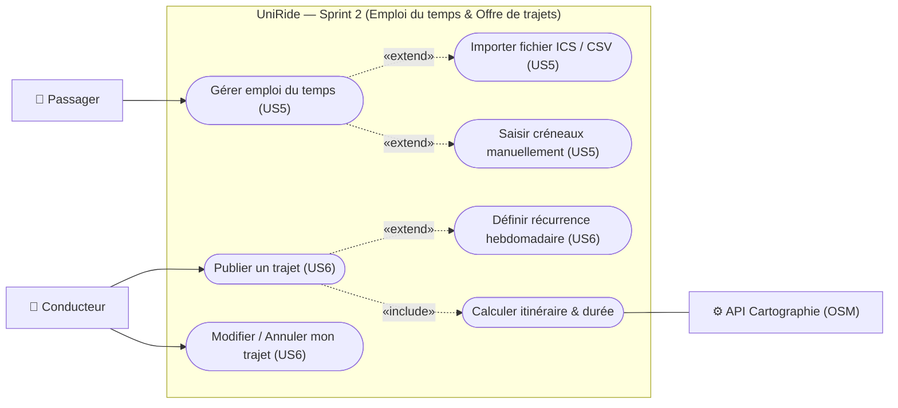

### Diagramme de Classes — Sprint 2

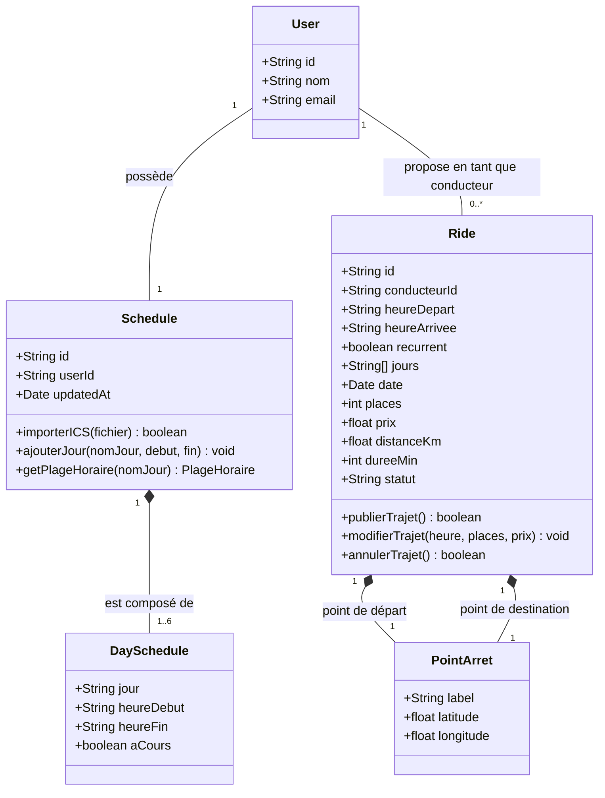

---

## Sprint 3 : Recherche, Carte, Réservation & Validation (US7 à US10)

### Objectifs
- **US7 :** Rechercher un trajet avec filtres (destination ISET, date, plage horaire, prix max).
- **US8 :** Visualiser le tracé routier sur une carte interactive (Leaflet / OpenStreetMap).
- **US9 :** Réserver une ou plusieurs places et suivre le statut de la demande.
- **US10 :** Permettre au conducteur d'accepter ou de refuser les demandes avec décrément atomique des places.

### Diagramme de Cas d'Utilisation — Sprint 3

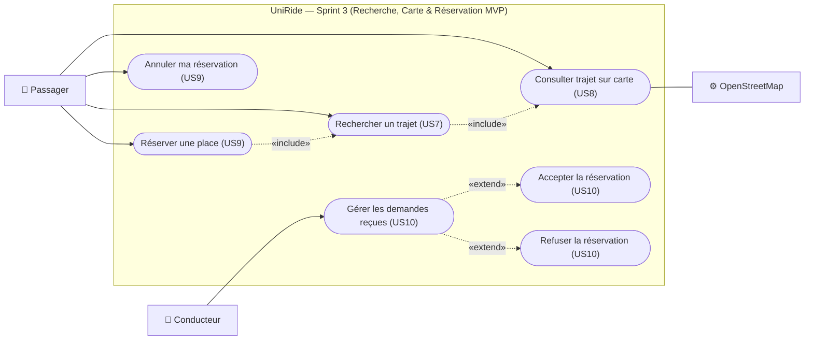

### Diagramme de Classes — Sprint 3

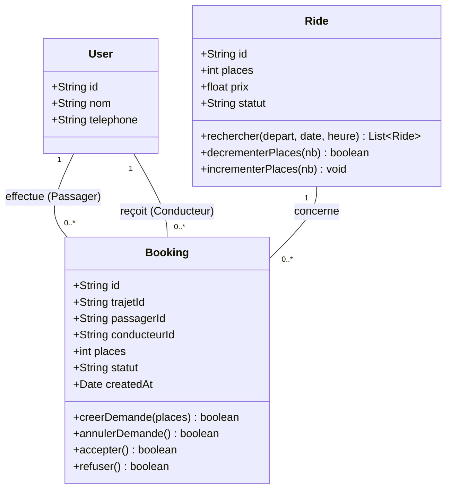

---

## Sprint 4 : Matching intelligent, Notifications & Trajet en direct (US11, US13, US21)

### Objectifs
- **US11 :** Calculer automatiquement le score de compatibilité /100 entre passager et conducteur (35% proximité, 35% horaires, 15% préférences, 15% réputation).
- **US13 :** Notifier en temps réel les étudiants (réservation acceptée, rappel départ 30 min, annulation).
- **US21 :** Démarrer le trajet (mode direct), afficher la jauge d'avancement et le terminer avec statistiques générées.

### Diagramme de Cas d'Utilisation — Sprint 4

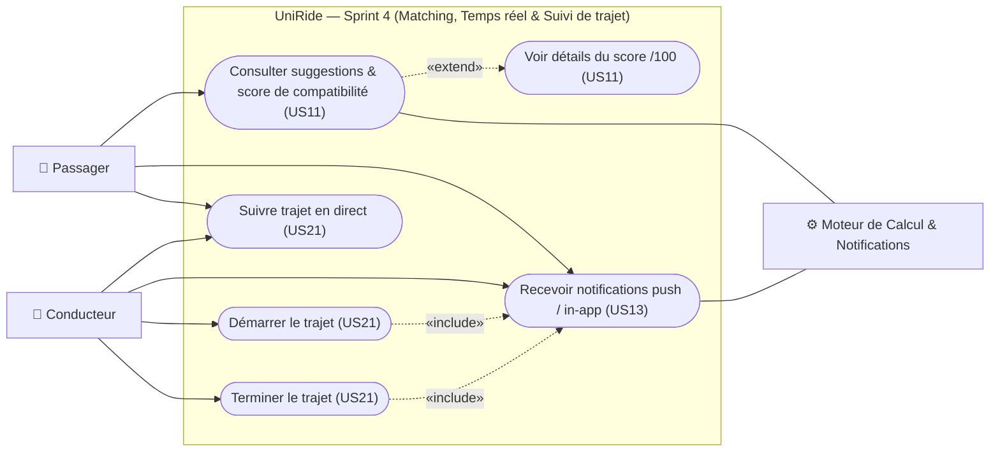

### Diagramme de Classes — Sprint 4

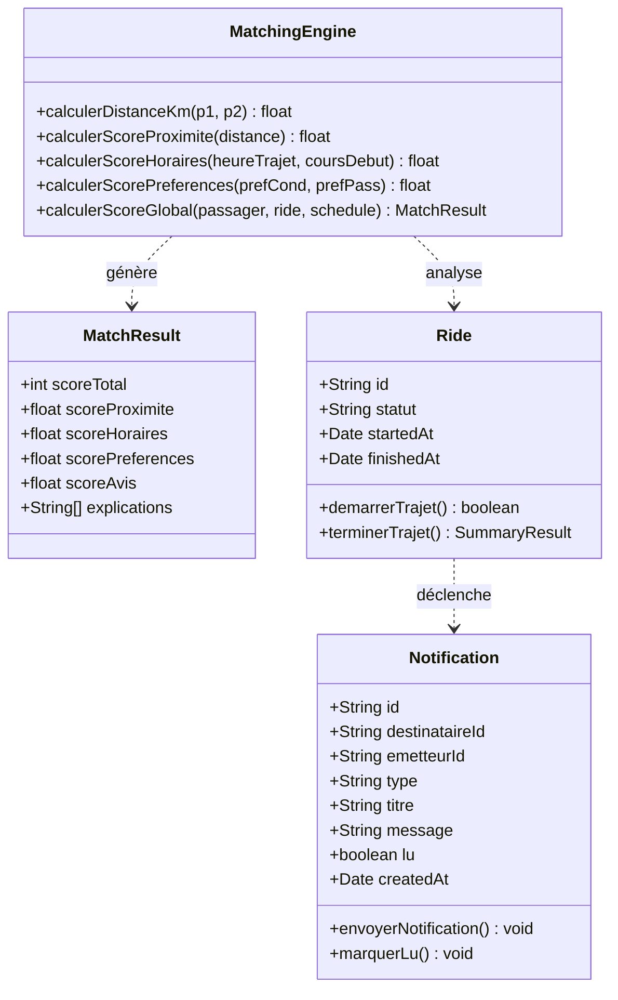

---

## Sprint 5 : Communication, Évaluations, Signalements & Badges (US12, US14 à US17)

### Objectifs
- **US12 :** Messagerie instantanée en temps réel (Socket.io) entre covoitureurs.
- **US14 :** Noter mutuellement le covoitureur (1 à 5 étoiles, commentaire et sélection de compliments).
- **US15 :** Signaler un utilisateur en cas de retard grave, conduite dangereuse ou comportement inapproprié.
- **US16 & US17 :** Calculer l'argent économisé, les kg de CO₂ évités et débloquer les badges de mérite.

### Diagramme de Cas d'Utilisation — Sprint 5

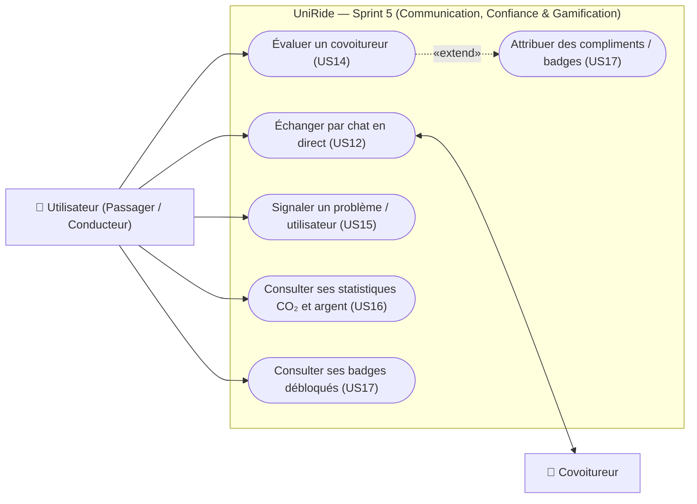

### Diagramme de Classes — Sprint 5

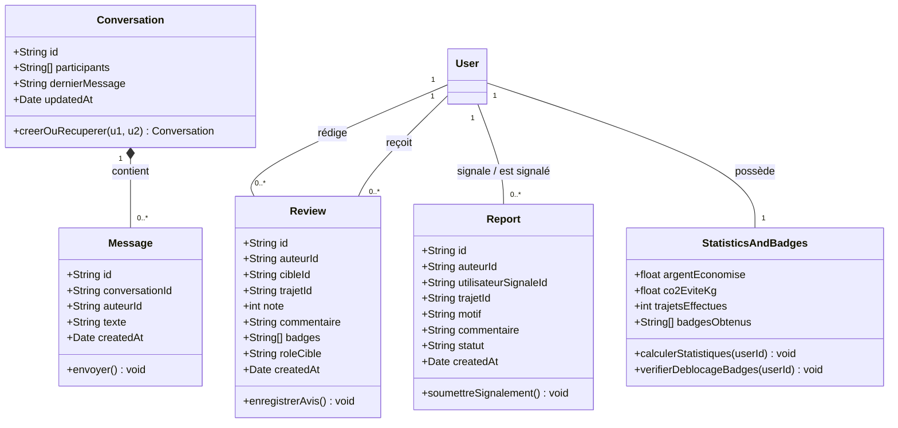

---

## Sprint 6 : Administration, Sécurité SOS & Tableaux de bord (US18 à US20, US22)

### Objectifs
- **US18 :** Gérer les utilisateurs (consulter, bloquer/débloquer avec motif, supprimer un compte).
- **US19 :** Traiter les signalements avec compteurs en temps réel (À traiter, Traités, Rejetés) et décision administrative.
- **US20 :** Tableau de bord global avec KPIs (étudiants actifs, taux de satisfaction, conducteurs, trajets effectués).
- **US22 :** Bouton SOS (envoi SMS du lien GPS au contact de confiance, alerte temps réel Socket.io à l'administration, numéros nationaux 197/190/198).

### Diagramme de Cas d'Utilisation — Sprint 6

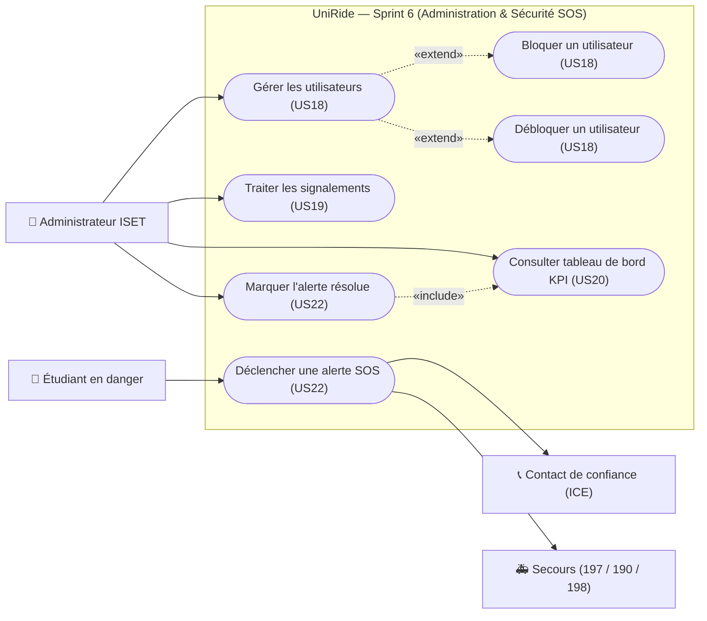

### Diagramme de Classes — Sprint 6

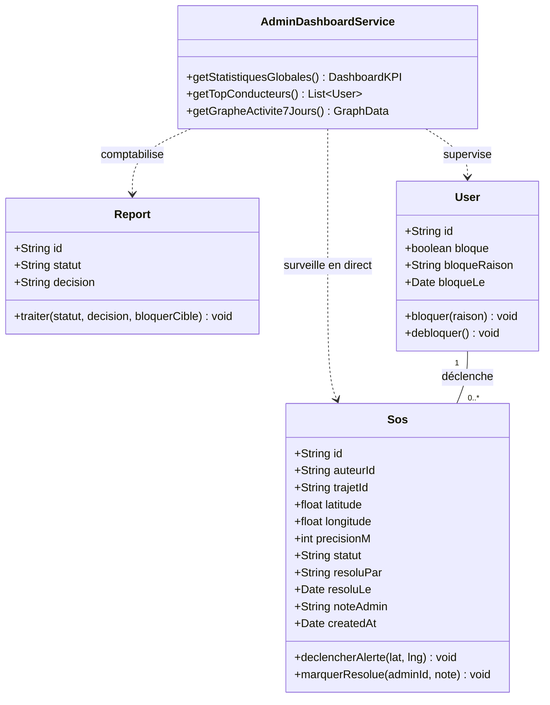

---

## 8. Diagramme de Classes Global du Système

Ce diagramme unifie l'intégralité du modèle de données et des composants métiers du projet UniRide :

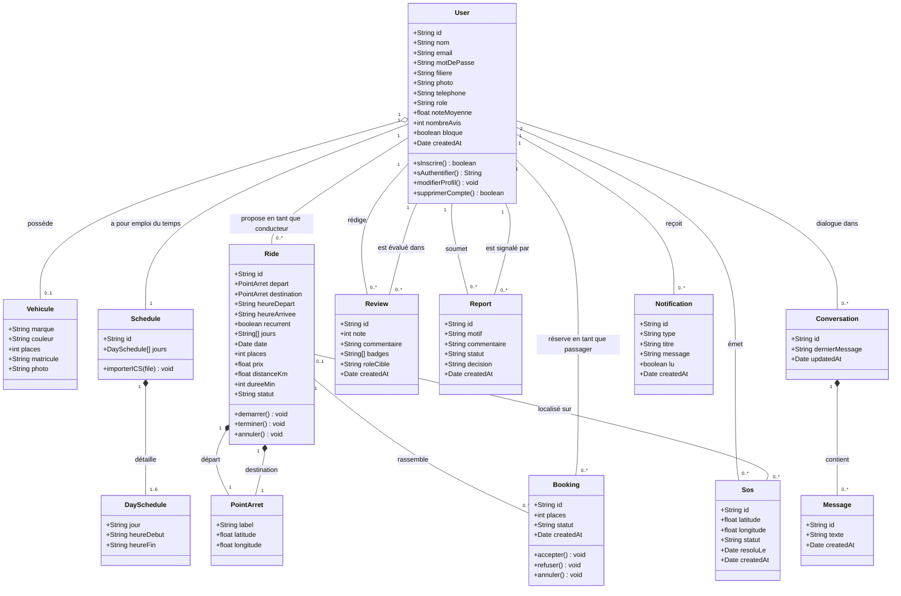
